# DIY 1 — Claude chat: five habits that make answers better

**Goes with:** Demo 1 in the talk (the chat window).
**Time:** about 10 minutes.
**Where:** [claude.ai](https://claude.ai) in your browser, or the Claude desktop app. Any plan works, including Free (the model list will be shorter).
**Files:** both are in [`diy-01-chat/files/`](files/) in this repo, and both are made up:

| File | What it is |
|---|---|
| `tidewater-db-service-agreement.pdf` | A 2-page service agreement from **Tidewater Cloud**, a fictional database host |
| `helpdesk-september.png` | A chart of a month of help desk tickets for **Lantern Lane Books**, a fictional bookshop (sample data) |

**What you'll practice:**

1. Say who it's for, what you want, and what shape the answer should take.
2. Pick the model and effort level for the job.
3. Give it your files, and make it quote where its answer came from.
4. Test it by asking something the file *doesn't* say.
5. Show it pictures: screenshots, charts, photos of a whiteboard.

---

## Get ready

- Find the two sample files. If you cloned this repo, they're in **`claude-diy/diy-01-chat/files/`**. To open that folder in Finder, run this from the top of the repo (the `claude-diy` folder):

  ```bash
  open diy-01-chat/files
  ```

  (Windows: `explorer diy-01-chat\files`.) Keep that window open next to your browser so you can drag files into the chat. Didn't clone? Open [`files/`](files/) on GitHub, click each file, and use the download button.
- Open [claude.ai](https://claude.ai) and start a **new chat**.
- Optional: use an **incognito chat** (the ghost icon at the top right) if you don't want this practice run saved or remembered. (Skip it if you plan to do DIY 5 in the same session: Design doesn't work in incognito chats.)

---

## Steps

### 1. Pick a fast model for a quick question

Click the **model name** just below the message box, on the right (it reads something like "Opus 5.5 High"). Look at two things:

- the **list of models**: bigger ones are smarter but slower and use more of your plan,
- **Effort** (point at it to open its list, if your plan shows one): how hard it thinks before answering. Higher effort uses your limits faster.

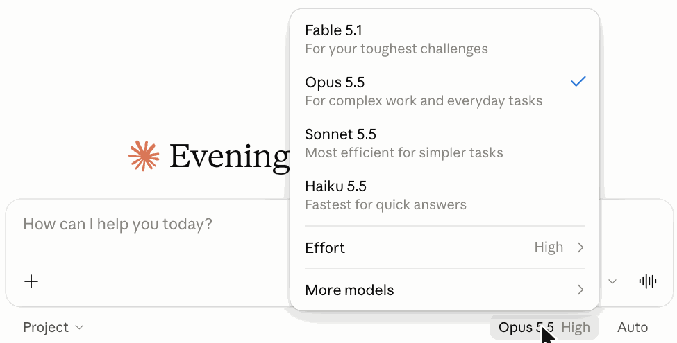

Pick a **smaller, faster model** (Haiku, for example) and set Effort to **Low**. A quick explanation doesn't need the biggest model thinking hard. Each model remembers its own effort setting, so picking Haiku may switch Effort to Low by itself; check the label under the message box.

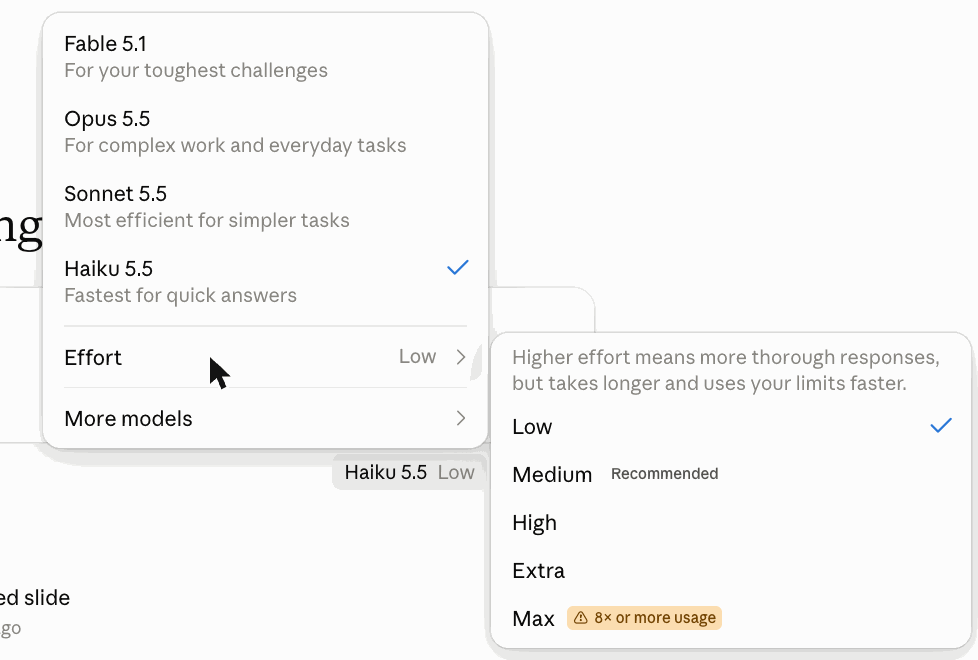

> The names and options change over time. Go by what your menu shows.

### 2. Ask with who / what / shape

Paste:

```text
I'm a project manager who has never used an AI assistant at work. In 3 short bullets, tell me the most useful things you can help with beyond answering questions, with one concrete example each. Under 80 words.
```

**What you should see:** a quick answer that sticks to 3 bullets and stays short. Who you are, what you want and the shape of the answer do more than any "magic" phrase.

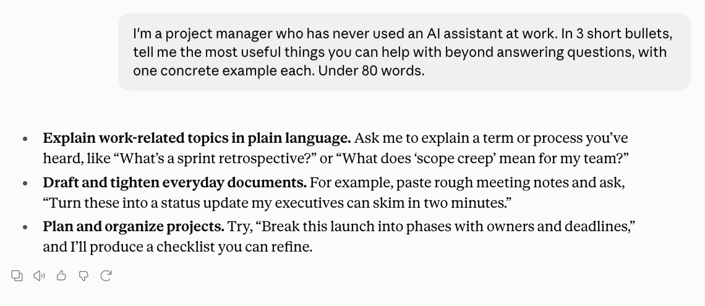

### 3. Edit the question instead of arguing with the answer

Hover over your message: a few small icons appear **just below it, on the right** (a time, retry, a **pencil**, copy). Click the **pencil**.

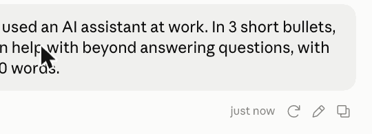

Your message turns into an editable box. Click into the text, change "project manager" to **"high school science teacher"**, and click **Save**.

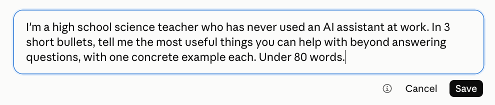

**What you should see:** a new answer with examples that fit a teacher (quizzes, explaining ideas at different levels, feedback against a rubric). The edited question replaces the old one, so the conversation stays clean. If an answer misses, fixing the question beats piling on corrections.

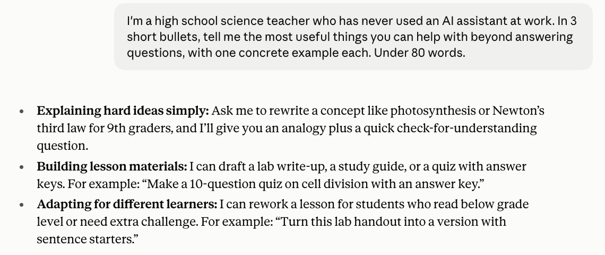

### 4. Switch up for real work

You don't need to start a new chat: you can switch right here, and the next message uses the new model.

Click the model name below the **Reply** box (it still says something like "Haiku 5.5 Low"). Mid-conversation the menu is shorter: it shows only the **current** model, **Effort** and **More models**. Point at **More models**, then move the pointer to the right, into the list that opens. Click the **most capable model** you have (Opus, for example).

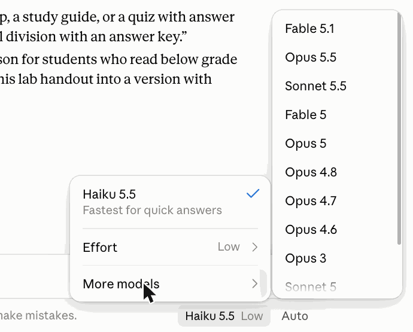

The label under the Reply box changes. Check that Effort is **High** (Opus remembers its own effort setting, so it's often already High). The next step is a contract, which deserves the bigger model thinking harder.

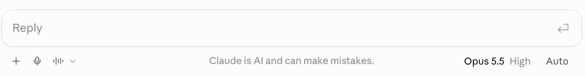

### 5. Attach a document and make it quote

Drag **`tidewater-db-service-agreement.pdf`** from `claude-diy/diy-01-chat/files/` into the message box (or click **+** → **Upload or add files**). A small preview of the PDF appears in the box. Then paste:

```text
I'm about to sign up for this database service for my team. What's in here that could surprise us later? For each item, quote the exact sentence and give the section number.
```

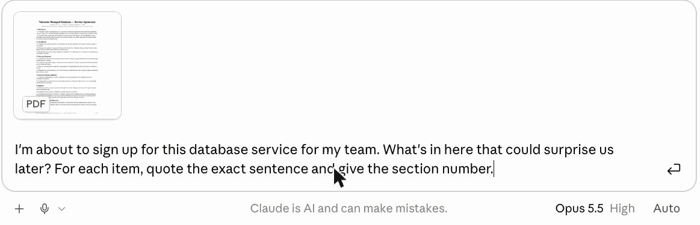

**What you should see:** a list where every item has a quote and a section number. The agreement has several surprises planted in it. A good answer finds most of these:

| Section | The surprise |
|---|---|
| **5.3** | It collects usage data from **every** customer database by default. Opting out takes a written email and up to **45 days**. (Hidden in the *Support* section.) |
| **8.3** | After you cancel, you have only **10 days** to export your data, then it and all backups are deleted for good. |
| **8.4** | Exports over 50 GB cost **$0.12 per GB**. |
| **9.2** | They can show **your company's name and logo** in their marketing unless you say no in writing. |
| **11.1 + 3.4** | It **renews automatically** every 12 months (60 days' notice to cancel), and the price can go **up 15%** each renewal. |
| **10.3** | Their liability is capped at **one month** of fees. |
| **12.2** | They can change the agreement by posting a new version. |

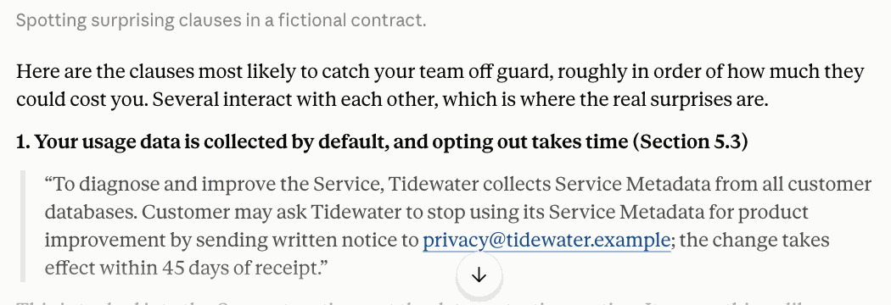

In both of our test runs (Opus, High) it found all seven, plus a few more (short backup window, paid restores). It may also point out that the 30-day price notice comes *after* the 60-day cancel deadline.

Now **check one yourself**: open the PDF, find section 9.2, and confirm the sentence is really there. Asking for quotes and section numbers turns "trust me" into "check me."

### 6. Ask something the document doesn't say

Paste:

```text
Which country will our data be stored in?
```

**What you should see:** it should say the agreement **doesn't say**. Section 2.3 only says the service runs in data centers operated by Tidewater "or its subprocessors," with a list "available on request." "It's not in there" is the answer you want. That's the best quick test of any AI tool.

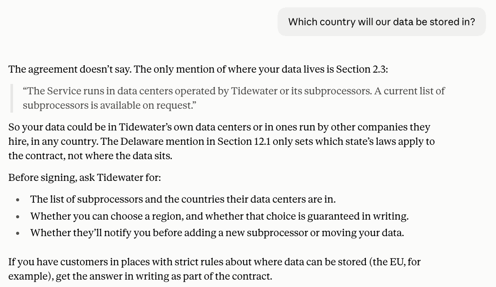

### 7. Show it a picture

Drag in **`helpdesk-september.png`**, also from `claude-diy/diy-01-chat/files/` (or take a screenshot of any chart and paste it straight in). Then paste:

```text
What happened here? Write a 3-sentence update for our team chat. Is there anything else in this chart I should worry about?
```

**What you should see:**

- The obvious story: tickets jumped right after the **new billing page on Sep 9** and dropped back after the **fix on Sep 12**.
- **The bonus:** after the team **switched help desk tools on Sep 18**, the time to first reply crept up from about **2 hours to over 3**, and kept climbing, even though ticket numbers were back to normal. You didn't ask about that. If it catches it, that's the moment to remember.

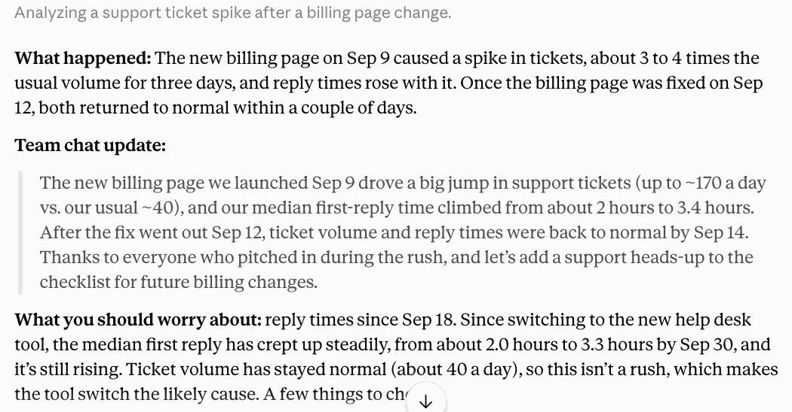

---

## Want more? (optional)

**Turn it into something you can keep.** Paste:

```text
Turn the agreement findings into a one-page checklist I can share with my team before we sign.
```

It still remembers the PDF from earlier in the chat. The result opens beside the chat as a document with tick boxes you can edit, comment on, share or download. (It's saved as a document in your account, even from an incognito chat.)

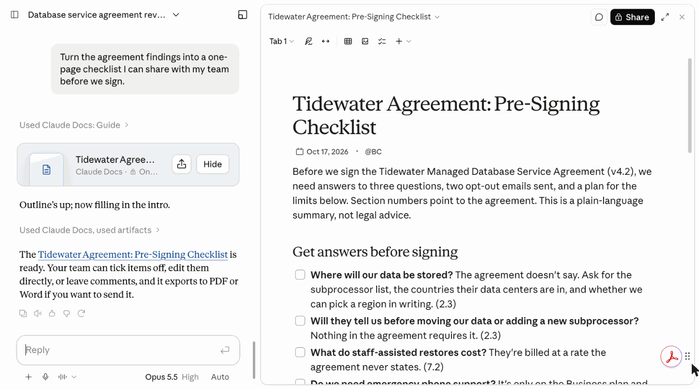

**Look something up on the web.** Paste:

```text
Search the web for the most recent Claude Code release notes and summarize the three biggest changes. Link your sources.
```

On its own, Claude only knows what it learned up to a cutoff date. With search, it looks things up (you'll see a line like *Read 3 pages, searched the web*) and shows its sources so you can check them. Web search is usually on already; there's no switch for it in the message box's **+** menu.

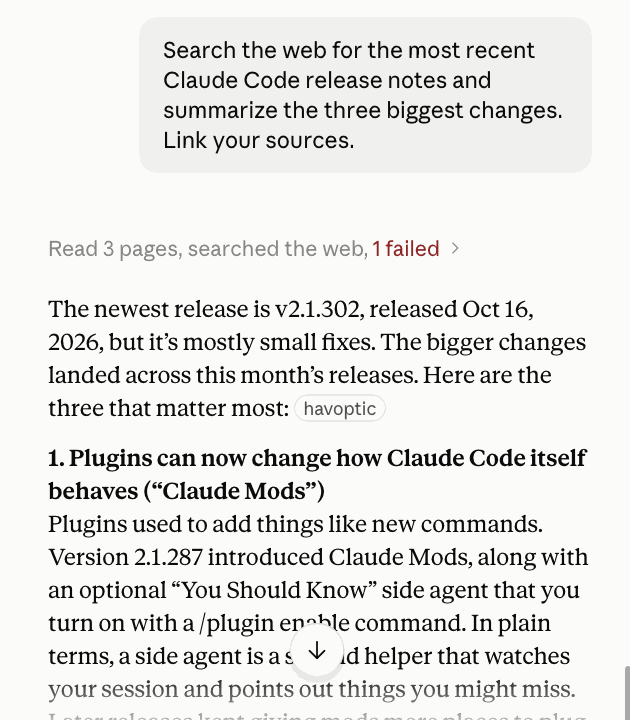

> In the **+** menu, don't confuse **Research** with web search. Research is a longer, deeper mode; when it's on, a highlighted icon appears next to the **+**. Click that icon to turn it off.

---

## Start over

Start a new chat. Nothing on your computer changes. New chats start with the model you picked **on the new-chat screen** in step 1 (the small one), not the one you switched to mid-chat in step 4. Set it back to your usual model and effort.

## If something goes wrong

- **No effort setting in the menu:** some plans and models don't show one. The model choice is still the main dial.
- **It misses some of the surprises:** that's normal; answers vary run to run. Ask, "Anything about what happens to our data when we cancel?" and see if it finds 8.3. Then remember why you asked for quotes.
- **It claims the agreement names a country:** ask it to quote the sentence. It won't be able to, which is the lesson.
- **Can't upload files:** check you're signed in. Free plans have upload limits; try again later or use one file at a time.
