# DIY 2 — Claude Code: one bug, start to finish

**Goes with:** Demo 2 in the talk (one task, start to finish in Claude Code).
**Time:** about 12 minutes.
**Where:** a terminal, with Claude Code installed and logged in.
**Project:** a tiny checkout program for **Lantern Lane Books** (a made-up shop). It has 6 passing tests and one bug: **if the customer doesn't enter a coupon code, checkout crashes.**

**What you'll practice:**

1. Describe the problem and what "done" looks like. Claude does the digging.
2. **Plan mode** = look, don't touch. Approving the plan is where your review counts most.
3. A test turns "probably fixed" into "proven fixed." **`/goal`** makes Claude keep going until a condition is true.
4. You read the changes and decide when they're committed. The project's rules file (`CLAUDE.md`) holds Claude to that.
5. Hand a side job to a **background agent** and check on it from one screen. It works in its own copy of the project, so it never steps on your work.

---

## Get ready

From the top of this repo:

```bash
python3 setup_diy.py 2
```

It copies the project to `~/atc-diy/checkout`, makes it a git project, and runs the tests. It should end with **Ran 6 tests … OK**. Always work in that copy, never in this repo's `starter/` folder.

> **Windows:** use `python` instead of `python3` if that's what you have. The commands below work in PowerShell, Git Bash or WSL.

Then:

```bash
cd ~/atc-diy/checkout
```

---

## Steps

### 1. See the bug

```bash
python3 checkout.py 80 SAVE-15
python3 checkout.py 40
```

**What you should see:** the first prints `Total to pay: $68.00`. The second (no coupon) crashes with an `IndexError`. That's our bug report.

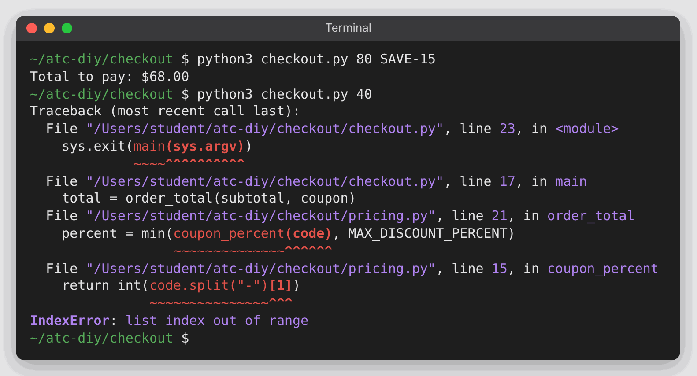

### 2. Read the house rules

```bash
cat CLAUDE.md
```

Claude reads this file automatically at the start of every session. Note the last line: **don't commit until I've reviewed the changes.**

### 3. Hand off a side job to a background agent

Still at your normal terminal prompt (not inside Claude Code yet):

```bash
claude --bg 'Write a short CONTRIBUTING.md for this project: how to run it, how to run the tests, and the house rules from CLAUDE.md' --permission-mode dontAsk --allowedTools 'Read,Write,Edit'
```

It asks whether you trust this folder (once per new folder). **The highlight starts on *No, exit*,** so don't just press Enter: press the **↓** arrow once to move to **Yes, I trust this folder**, then press **Enter**.

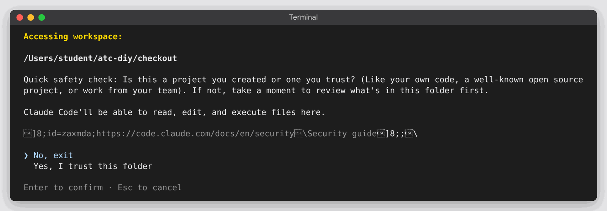

**What you should see:** `backgrounded · <id>` and a few commands you could use, then your prompt comes straight back. The agent is working by itself. The end of that line is its rule book: it may read and write files, and anything else is refused instead of waiting for you, so it can never get stuck asking a question nobody is there to answer.

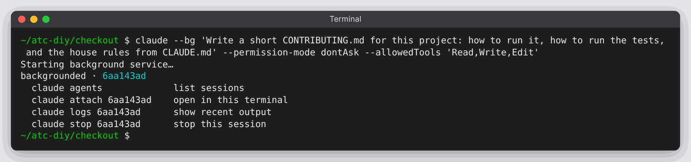

### 4. Start Claude Code in plan mode

```bash
claude
```

Look at the line under the message box. It usually starts as **auto mode on**. Press **Shift+Tab** until it reads **plan mode on**. Each press moves one step around this loop: *auto* → *manual* → *accept edits* → *plan* → back to *auto*. From auto mode that's **three presses**. (The very first time you run Claude Code after installing or updating it, it starts in *manual* instead, and it's two presses.)

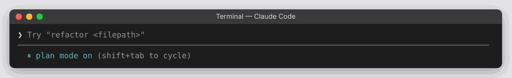

Plan mode means Claude can read everything and change nothing.

### 5. Describe the bug and the finish line

Paste:

```text
Checkout crashes when a customer doesn't enter a coupon code. Find out why. Then write a test that reproduces the crash and run the tests so I can see it fail. Don't fix the code yet.
```

**What you should see:** it opens `checkout.py`, `pricing.py` and the tests (it may even run `python3 checkout.py 80` to see the crash), then names the cause: `code.split("-")[1]` in `pricing.py` fails when there's no dash in the code. **Bonus:** it may notice that *any* code without a dash (like `WELCOME`) crashes too, not just an empty one. Then it shows you a **plan**.

### 6. Approve the plan

Read the plan. Approve it with the option that approves **and** lets it carry on by itself (it reads something like **"Yes, and use auto mode"**; pick what your screen shows). It's usually already highlighted: press **Enter**. (Use the **↑**/**↓** arrows to move the highlight.)

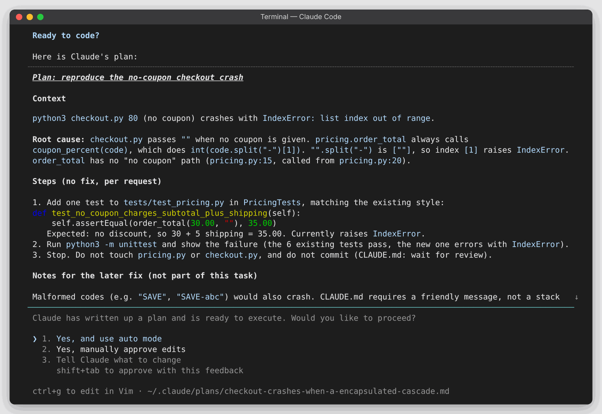

This is the review that matters most: catching a wrong idea in the plan is far cheaper than catching it in the code.

### 7. Watch the test fail first

**What you should see:** it adds a test to `tests/test_pricing.py`, runs `python3 -m unittest`, and stops with the test **failing**. Claude Code folds command output into one grey line (`Ran 1 shell command`), so you'll see its summary ("errors with an IndexError") rather than the raw `FAILED (errors=1)`. Want the raw output? Press **Ctrl+O** to expand everything, and **Ctrl+O** again to go back.

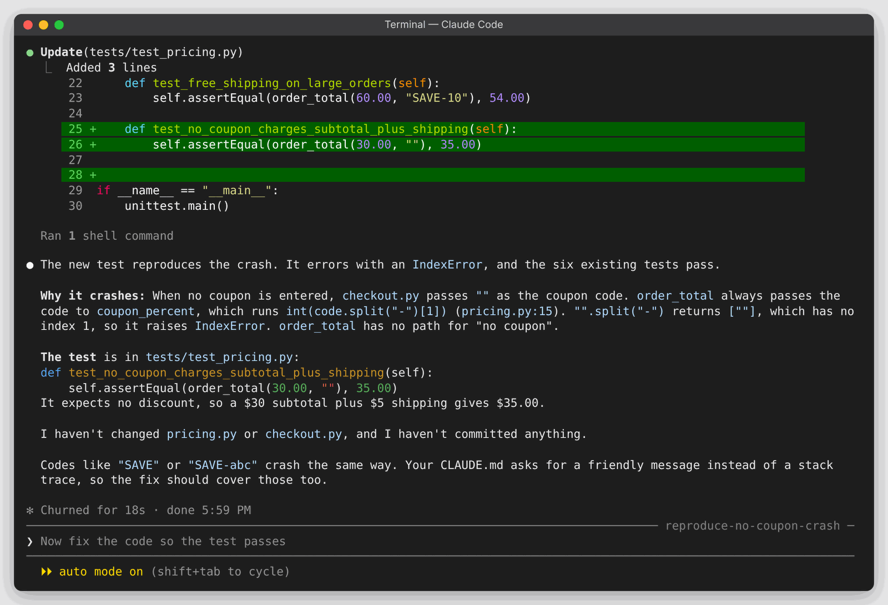

It may offer to fix it, and grey text may appear in the message box (like *Now fix the code so the test passes*). That grey text is only a suggestion: nothing is sent unless you accept it (with **Tab**) and press Enter. Just type your next message; it replaces the grey text. Go to the next step.

Red, on purpose: the bug is now captured as a test.

### 8. Give it a finish line with `/goal`

Paste:

```text
/goal python3 -m unittest reports OK with no failures or errors. Do not edit or delete any existing test.
```

`/goal` means: keep working, and you can't stop until this is true. After each round, a separate, smaller model checks whether the condition holds; if not, Claude goes back in. The last sentence is a guard: without it, the quickest way to "all tests pass" would be to change the test.

**What you should see:** a small fix in `pricing.py` (and often `checkout.py` too, so customers see a friendly message instead of a crash, as `CLAUDE.md` asks), the tests run again (7 tests OK, or 8 if it added more), and a line like **`✔ Goal achieved`**. The goal clears itself.

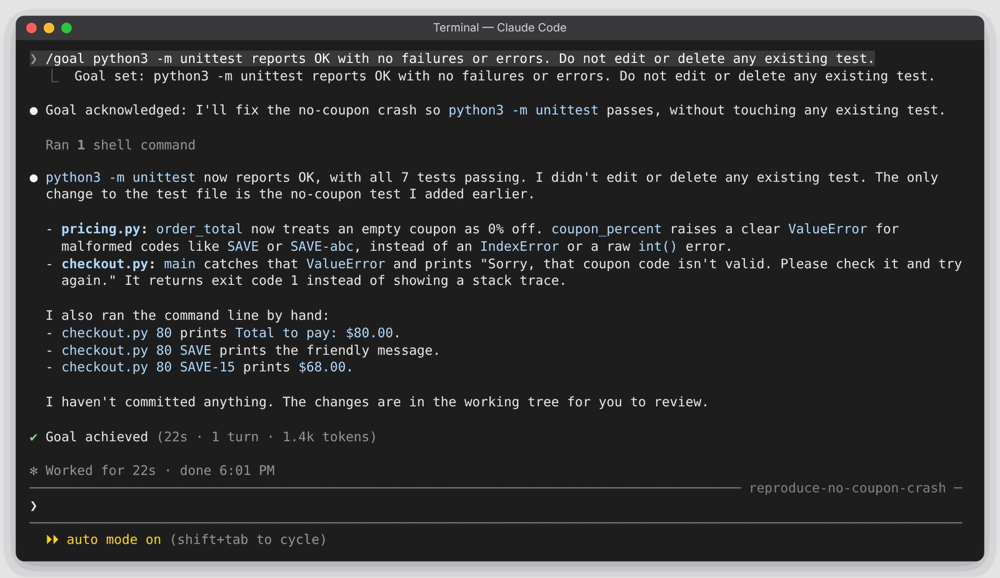

### 9. Review, then commit

Claude stopped without committing, because `CLAUDE.md` says to wait for your review. Check it (the `!` runs a normal terminal command inside Claude Code):

```text
! git status --short
```

You should see `M pricing.py` and `M tests/test_pricing.py` (and maybe `M checkout.py`): changed, not committed. Claude also reads the output and comments on it; that's normal.

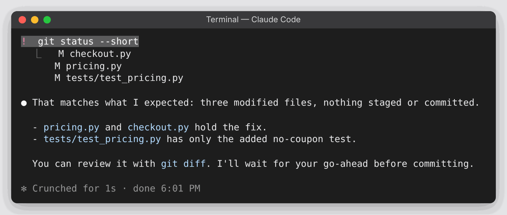

Now read the changes:

```text
! git diff
```

The diff is longer than the screen. Scroll up with your mouse wheel or trackpad (or **Page Up**) to read it, then scroll back down, or press **Ctrl+End** (the *Jump to bottom* hint on screen), to get back to the message box.

If you're happy, paste:

```text
Looks good. Commit it with a clear message.
```

Then:

```text
! git log --oneline -2
```

Your commit sits on top of **"Checkout: initial version."** You decided when it was done.

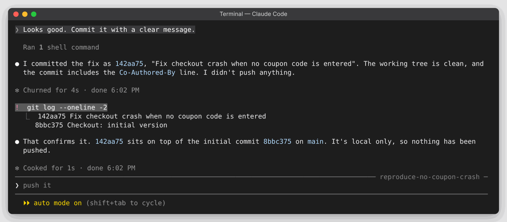

### 10. Check on the background agent

Leave Claude Code and open the agent view:

```text
/exit
```

```bash
claude agents
```

**What you should see:** a list with your CONTRIBUTING job under **Completed** (or still under **Working**). It's already highlighted. Its name is made up from the task, so it won't match ours exactly.

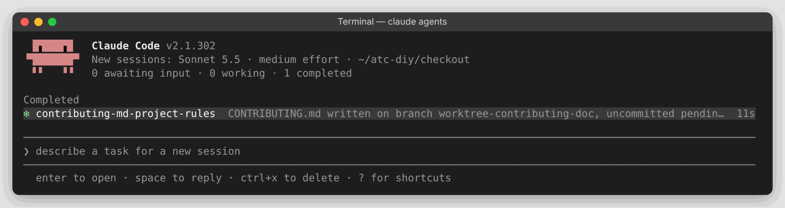

Press **Space** to open a card with its summary and a box to reply to it. Press **Esc** to close the card, and **Esc** again to leave the list. (Don't press `q`: here it types into the "describe a task" box.)

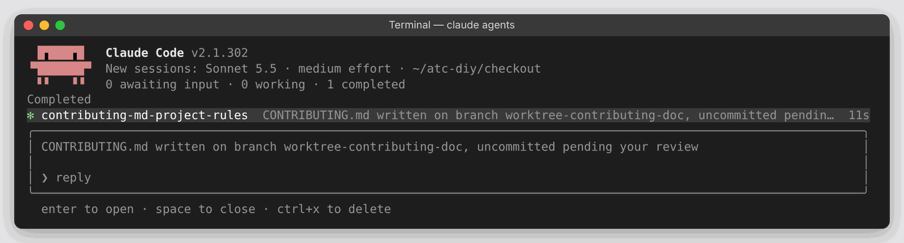

Now see where its work went:

```bash
ls CONTRIBUTING.md
ls .claude/worktrees/
git status --short
```

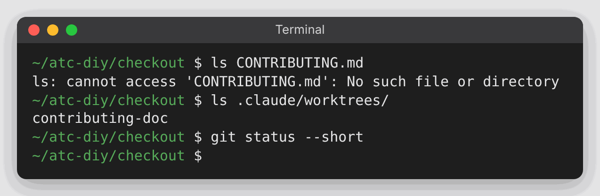

`ls CONTRIBUTING.md` says there's no such file, because it lives **only** inside `.claude/worktrees/<name>/`. `git status` shows nothing. (This project's `.gitignore` keeps that folder out of git.) The agent worked in its own copy of the project (a git **worktree**), on its own branch, so the two of you never collided.

---

## Start over

```text
/exit
```

```bash
claude agents          # Ctrl+X on the CONTRIBUTING job, Ctrl+X again to confirm, then Esc
                       # (if it isn't highlighted, use the arrow keys first)
python3 setup_diy.py 2 # from the top of this repo
cd ~/atc-diy/checkout
```

Delete the background agent **before** you rebuild the folder. Deleting it also removes its copy of the project and its branch; leftovers would point at a folder that no longer exists.

## If something goes wrong

- **`claude --bg` or `claude agents` isn't recognized:** update Claude Code (`claude update`). Skip step 3 and step 10 if you can't; the rest still works.
- **It fixes the code in step 7 even though you said not to:** it jumped ahead, which is why you check that it did what you asked. Run the `/goal` anyway: it finds the goal already met and finishes straight away.
- **Pressed Enter on the trust question and Claude Code quit:** the highlight starts on *No, exit*. Run the command again and pick **Yes, I trust this folder** with the ↓ arrow.
- **It asks permission for something:** read it and approve. That's the safety check working.
- **You can't scroll back to something:** in Claude Code, scroll with the mouse wheel or **Page Up**; **Ctrl+O** shows every step in full.
- **It commits on its own:** a rule in `CLAUDE.md` is strong guidance, not a lock. A hard guarantee needs a permission setting that forbids it.
- **`/goal` keeps going for more than a minute:** press **Esc**, then type `/goal clear`.
- **The CONTRIBUTING job isn't finished yet:** fine. It's working while you didn't wait. Check again in a minute.
- **`ls .claude/worktrees/` finds nothing:** the agent hadn't started writing yet. It only makes its own copy when it's about to change something.
- **`python3` isn't found (Windows):** use `python`. In step 8, write `python -m unittest` in the goal too.
