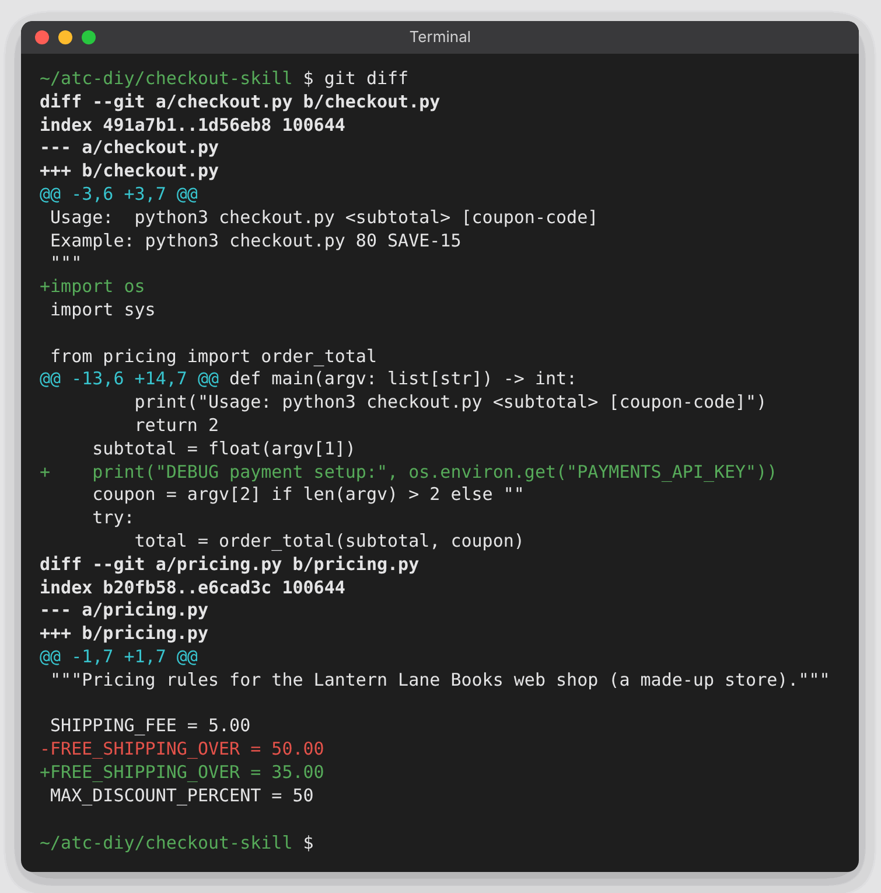
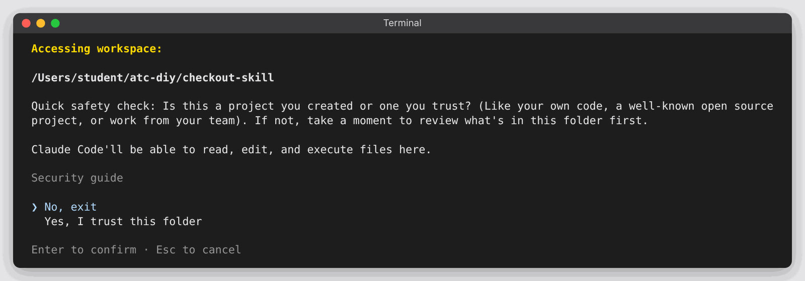
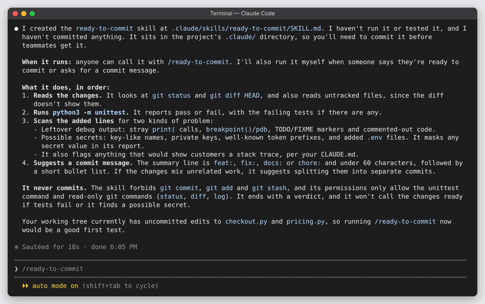
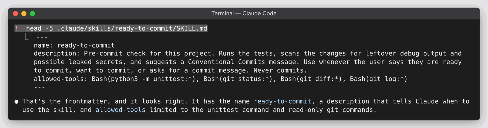
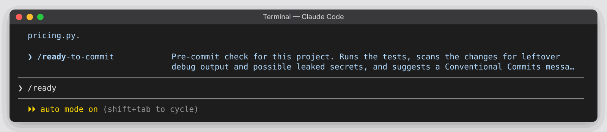
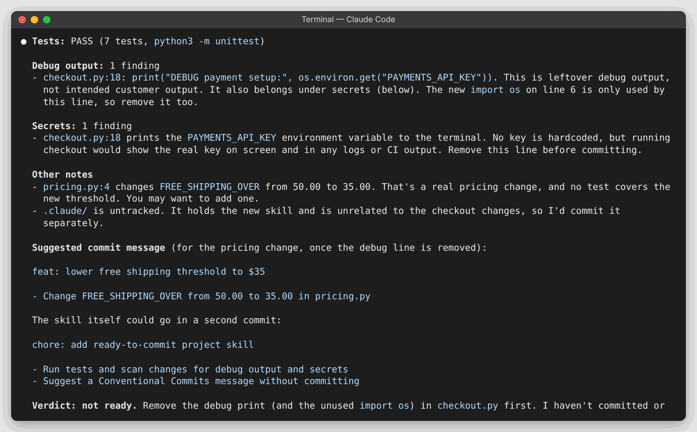
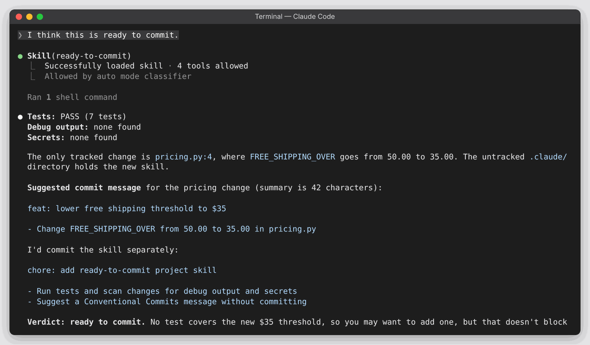
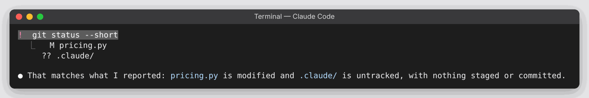

# DIY 3 — Turn a routine into a skill

**Goes with:** Demo 3 in the talk (have Claude turn a routine into a skill).
**Time:** about 8 minutes.
**Where:** a terminal, with Claude Code installed and logged in.
**Project:** the same Lantern Lane Books checkout from DIY 2, "a day later." Yesterday's fix is committed, and there's a small new change that isn't committed yet. **Hidden in it: a leftover debug line that prints the payment API key.** Your new skill should catch it.

You don't need to have done DIY 2 first. The setup script builds this folder on its own.

**What you'll practice:**

1. **Do something more than twice? Make it a skill.** Describe the routine in plain words; Claude writes the file.
2. A skill is **just a markdown file** in your project. The short **description** at the top is how Claude knows when to use it.
3. Two ways to run it: **type `/name`**, or **just ask**, and Claude picks it.
4. It lives in the repo, so **commit it and your whole team gets it.**

---

## Get ready

From the top of this repo:

```bash
python3 setup_diy.py 3
```

It should end with `changed, not committed: checkout.py, pricing.py` and **Ran 7 tests … OK**. Then:

```bash
cd ~/atc-diy/checkout-skill
git diff
```

Look at the diff: free shipping now starts at $35 (a real change)… and a `DEBUG` line that prints `PAYMENTS_API_KEY`. Easy to miss when you're in a hurry. The tests still pass, so they won't catch it.



> **Stuck in the diff?** If your terminal window is small, `git diff` opens in a viewer and the last line shows `:` or `(END)` instead of your prompt. Use the arrow keys to scroll, and press **q** to get back to the prompt.

> **Run the setup script before starting Claude Code.** It creates an empty `.claude/skills` folder first, which lets a brand-new skill work straight away without a restart.

---

## Steps

### 1. Start Claude Code

```bash
claude
```

It asks whether you trust this folder. **The highlight starts on *No, exit*:** press **↓** once to move to **Yes, I trust this folder**, then **Enter**.



Look at the line under the message box. It usually reads **auto mode on**, which is what you want. If it says **manual mode**, Claude will ask before running each command; just approve them as they come, or press **Shift+Tab** until it reads **auto mode** so it asks less.

### 2. Describe your routine and let Claude write the skill

Paste:

```text
Before every commit I do the same things: run the tests, check my changes for leftover debug output or anything that could leak a secret like an API key, and write a commit message in our team's style: Conventional Commits (feat:, fix:, docs: or chore:), a summary line under 60 characters, then a short bullet list of what changed. Turn that into a project skill called ready-to-commit that anyone on the team can use, and that you use on your own whenever someone says they're ready to commit. It should never commit by itself. It should just report what it found and suggest the message.
```

**What you should see:** it creates `.claude/skills/ready-to-commit/SKILL.md` and summarizes what the skill does. If it asks before making the folder or writing the file, approve it. No new syntax: you described what you do the way you'd explain it to a new teammate.



Grey text may appear in the message box afterwards (like `/ready-to-commit`). It's only a suggestion; type over it.

### 3. Read what it wrote

Start with the top of the file:

```text
! head -5 .claude/skills/ready-to-commit/SKILL.md
```

(The `!` runs a normal terminal command inside Claude Code. Claude also reads the output and comments on it; that's normal.)



Then the whole thing:

```text
! cat .claude/skills/ready-to-commit/SKILL.md
```

It's longer than the screen, so the top scrolls away. Scroll up with **Page Up** (or your mouse wheel) to read it, then scroll back down or press **Ctrl+End**. Look for three things:

- **The top block** between the `---` lines: a `name` and a **`description`**. The description is all Claude reads up front; it's how Claude knows *when* to use the skill.
- **An `allowed-tools` line**, if there is one: the commands the skill may run without asking (often just the tests and read-only git commands).
- **The steps**, and a line saying it **never commits**.

It's an ordinary file. You can edit it and review it like code.

### 4. Run it by name

Type `/ready` and pause: **`/ready-to-commit`** appears in the menu, highlighted. Press **Enter** to run it.



**What you should see:** the tests pass (7 tests), and the verdict says **not ready** (the wording varies: "NOT READY", "Fix first"). It flags the `DEBUG` line in `checkout.py` that prints the payment API key, and suggests a commit message (something like `feat: lower free shipping threshold to $35`) that leaves the debug line out. Nothing is committed.



The tests passed and it still says don't ship. Tests wouldn't catch that. The routine did.

### 5. Fix it, then let Claude pick the skill by itself

Paste:

```text
Remove that debug line.
```

Wait until it has finished (it says what it removed, and the message box is free again). Then, with **no slash command**, paste:

```text
I think this is ready to commit.
```

**What you should see:** a line like **`Skill(ready-to-commit)`**: it chose the skill on its own. This time the verdict is **ready**, with a suggested message. (It may suggest committing the new skill folder separately. Good advice.) It used the skill because the description says it's for "about to commit."



### 6. Share it with your team

```text
! git status --short
```



**What you should see:** `M pricing.py` (your $35 change) and `.claude/` listed as new (`??`). Commit that folder (for example, ask Claude: *"Commit the .claude folder on its own with your suggested message"*), and everyone who pulls the repo gets `/ready-to-commit`. Want a skill just for you, in every project? Put it in the `skills` folder inside `~/.claude/` instead.

---

## Start over

```text
/exit
```

```bash
python3 setup_diy.py 3   # from the top of this repo
cd ~/atc-diy/checkout-skill
```

The script deletes and rebuilds the folder, so `cd` into it again even if you're already "there".

## If something goes wrong

- **Pressed Enter on the trust question and Claude Code quit:** the highlight starts on *No, exit*. Run `claude` again and pick **Yes, I trust this folder** with the ↓ arrow.
- **`/ready-to-commit` isn't in the menu:** type `/reload-skills` and try again. Still missing? `/exit`, then `claude` again in the same folder.
- **It names the skill slightly differently** (like `ready_to_commit`): use the name on your screen.
- **It doesn't flag the debug line:** that's a real lesson: read the skill and improve it. Paste *"Update the skill so it always flags print statements that output environment variables, keys or passwords,"* then run it again.
- **In step 5 it doesn't pick the skill on its own** (it may just offer to commit): run `! head -6 .claude/skills/ready-to-commit/SKILL.md`. If you see `disable-model-invocation: true`, Claude made the skill "by name only," so it never picks it by itself. Delete that line and try again, or type `/ready-to-commit`. You can always call a skill by name.
- **It commits anyway:** a rule written in a skill is strong guidance, not a lock. A hard guarantee needs a permission setting that blocks commits.
