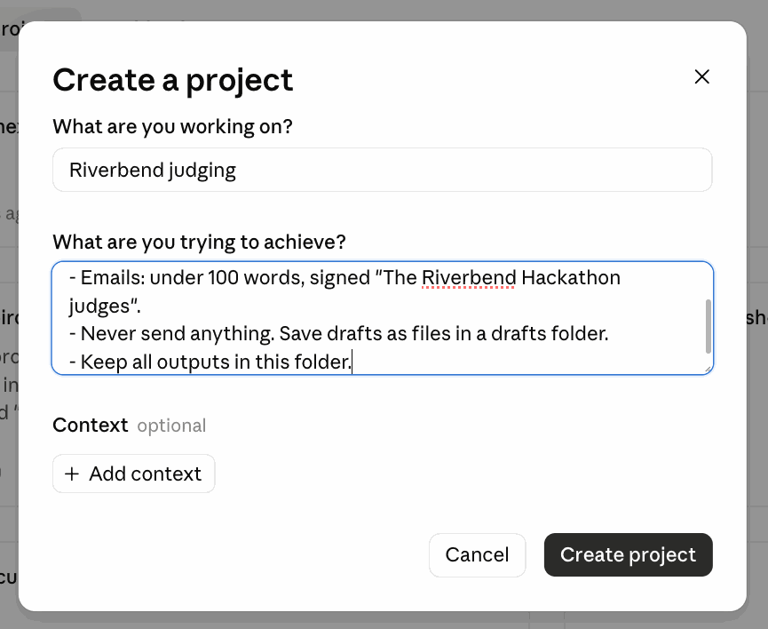
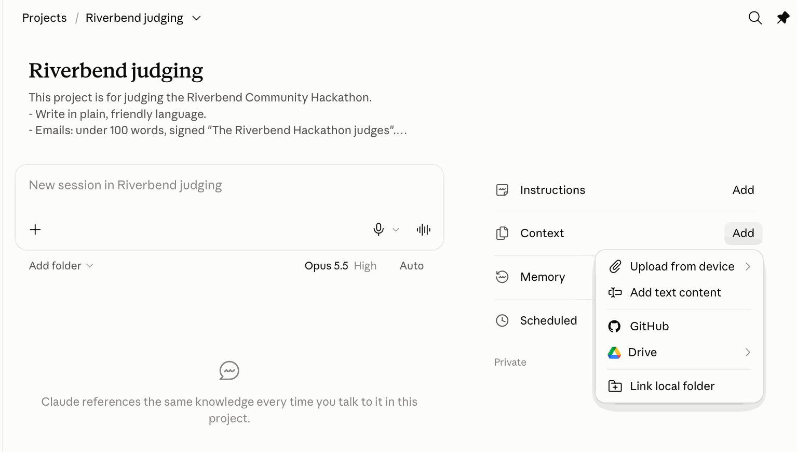
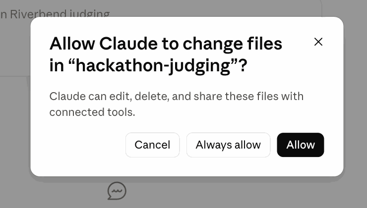
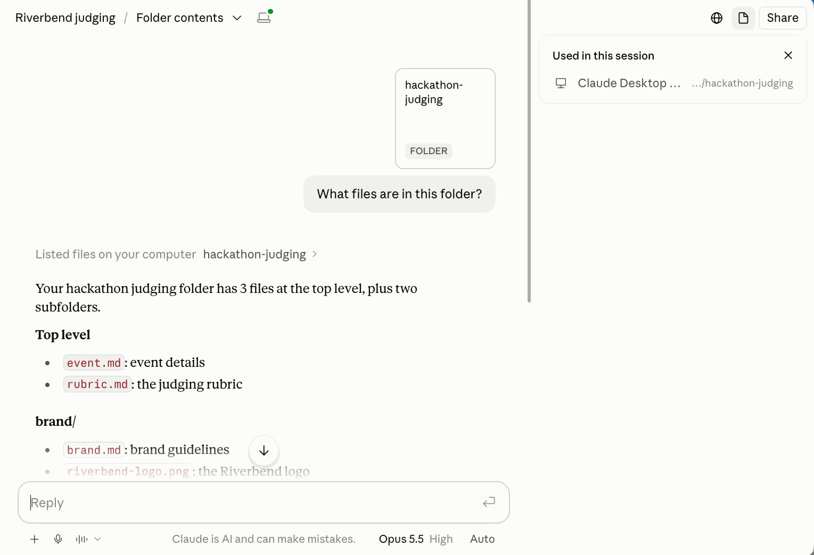
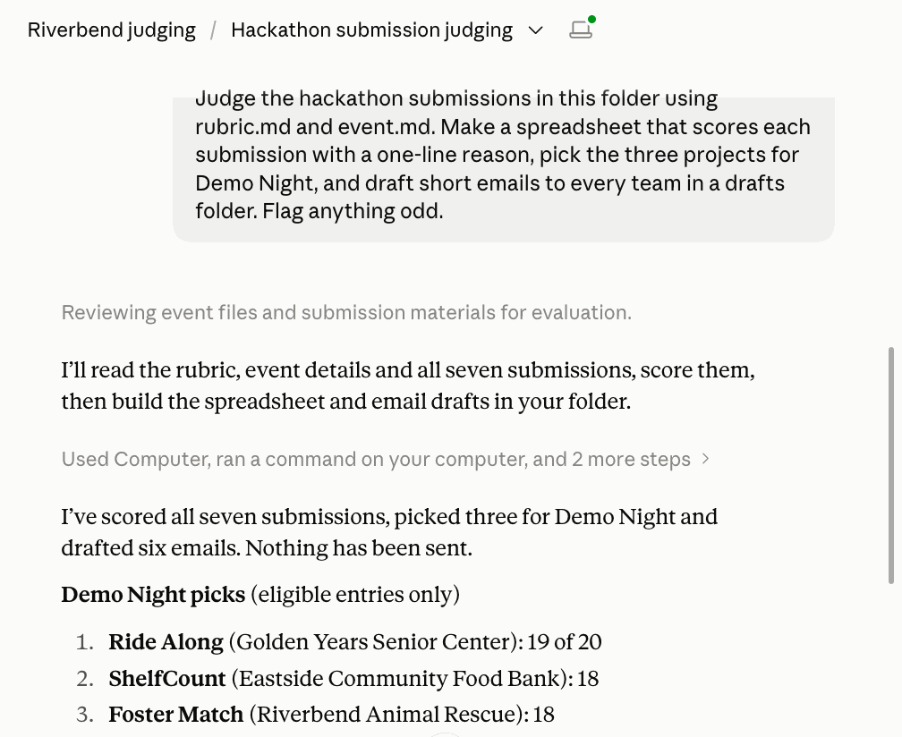

# DIY 4 — Cowork: a project, a folder, and real work

**Goes with:** Demo 4 in the talk (a Cowork project).
**Time:** about 12 minutes, plus a couple of minutes while Claude works.
**Where:** the **Claude desktop app** (not the browser), on a paid plan (Pro, Max, Team or Enterprise). The desktop app is what connects folders on your computer.
**The chore:** you're a judge for the **Riverbend Community Hackathon** (made up). Seven teams sent submissions in three file formats. You have a scoring rubric and one evening. Claude reads everything, scores it, makes a real spreadsheet, drafts the emails, and catches the things a tired judge misses.

**What's in the folder** (all fictional). The setup script below copies it to **`~/atc-diy/hackathon-judging/`**; the originals are in `claude-diy/diy-04-cowork/starter/`, plus `brand/` from `claude-diy/diy-05-design/files/brand/`:

- `event.md`: dates, the **noon deadline**, and the format: the top 3 projects present at Demo Night
- `rubric.md`: score 1–5 on Impact, It works, Clear, Original. **Not eligible:** late submissions, the same project entered twice, no link to the code. Ties go to all-first-timer teams.
- `submissions/`: **7 submissions as .md, .docx and .pdf**, with three traps built in. (Try to spot them yourself before Claude does. The answers are at the bottom of this page.)
- `brand/`: the hackathon's logo and colors (used in DIY 5)

**What you'll practice:**

1. **A project = a folder + your standing rules + memory.** Set it up once; every task in it starts informed.
2. **Describe the finished result**, not the steps. The **task list** shows Claude's plan before the work happens.
3. The output is **real files** (a spreadsheet you can sort, drafts you can edit), not a wall of chat text.
4. It **asks before risky moves** (like deleting files), and it **never sends** anything you didn't ask it to.

> **Where the work runs:** since October 6, 2026, new Cowork tasks on Pro and Max plans run in Anthropic's cloud. The desktop app sends a copy of each file the task opens, and only while the app is open. These files are made up, so that's fine for practice. Keep the app open until the task finishes.

---

## Get ready

From the top of this repo:

```bash
python3 setup_diy.py 4
```

It copies the folder to `~/atc-diy/hackathon-judging` and should report **7 submissions**. Use that copy, not the repo's `diy-04-cowork/starter/` folder: Claude will add files to it.

Copy these **project instructions** somewhere handy; you'll paste them in step 2:

```text
This project is for judging the Riverbend Community Hackathon.
- Write in plain, friendly language.
- Emails: under 100 words, signed "The Riverbend Hackathon judges".
- Never send anything. Save drafts as files in a drafts folder.
- Keep all outputs in this folder.
```

---

## Steps

### 1. Look at the pile

Open `~/atc-diy/hackathon-judging/submissions` in Finder or File Explorer. Seven files, three formats. Everybody has a pile like this.

### 2. Make the project and link the folder

In the **Claude desktop app** (the browser can't link folders on your computer):

1. In the left sidebar, click the **+** next to **Projects**.
2. A **Create a project** box opens. Under *What are you working on?* type **Riverbend judging**. Paste the **project instructions** from above into *What are you trying to achieve?* Don't use **Add context** in this box: it only takes files, so you can open the folder but never choose it. Click **Create project**.

   

3. The project's page opens, with your rules under its name. On the right, next to **Context**, click **Add** and choose **Link local folder** (at the bottom of the menu).

   

4. A Finder window opens. You want the **`hackathon-judging`** folder itself, the one that *contains* `event.md`, `rubric.md` and `submissions`. Don't pick `submissions`.
   1. Press **Cmd+Shift+G**, type `~/atc-diy`, and press **Return**. You now see `hackathon-judging` in the list.
   2. Click `hackathon-judging` **once** so it's highlighted. **Don't double-click it**: that opens the folder to show what's inside, instead of choosing it.
   3. Click **Open**.
5. Claude asks **Allow Claude to change files in "hackathon-judging"?** (now, or the first time it saves a file). Click **Allow**, or **Always allow** so it stops asking for this folder. It needs this to save the spreadsheet and the drafts.

   

**Check it worked:** in the project's message box (*New session in Riverbend judging*), ask *"What files are in this folder?"* It should list `event.md`, `rubric.md`, and the `brand` and `submissions` folders. If it says it has no folder, the folder didn't link; go back to step 3.



Notice what's in the rules: how emails are signed, how long they can be, and **never send anything**. You won't repeat any of it in the prompt.

### 3. Hand it the job

Start a new session from the project's page (the *New session in Riverbend judging* box). If you see a choice between **Chat** and **Cowork**, pick **Cowork**. Then paste:

```text
Judge the hackathon submissions in this folder using rubric.md and event.md. Make a spreadsheet that scores each submission with a one-line reason, pick the three projects for Demo Night, and draft short emails to every team in a drafts folder. Flag anything odd.
```

**What you should see:** a line saying what it's about to do, then a grey line like *Used Computer, ran a command on your computer, and 2 more steps* (click it to see each step), then a summary. Along the way it reads a PDF, two Word files and four markdown files. It may also show a short task list first: that's its plan, and your chance to catch a misunderstanding before seven wrong emails. If it asks to approve something, read it, then approve.



### 4. Check the payoff

When it finishes, read the summary. It should flag the three traps (see the answers at the bottom if you want to check), and pick three projects for Demo Night. Seven submissions but only **six** emails is right: two of the entries come from the same team.

Then open the **spreadsheet** it made in `~/atc-diy/hackathon-judging/` (something like `hackathon-scores.xlsx` or `scores.xlsx`): one row per submission, a score and a reason, and a note on the ones that aren't eligible. Open one file in `~/atc-diy/hackathon-judging/drafts/`.

**What you should see in the emails:** signed "The Riverbend Hackathon judges", under 100 words, and **saved, not sent**. You never said any of that in the prompt; the project instructions did.

### 5. New task, same project: it remembers

Start a **new task in the same project** and paste:

```text
Team Ride Along can't make Demo Night after all. Who takes their slot? Update the spreadsheet and the drafts to match.
```

**What you should see:** it picks the next eligible project from the scores, updates the sheet, writes a new invitation, and fixes the drafts that are now wrong. **It may ask before deleting files.** That's the default. You didn't re-explain the hackathon, the rubric or the rules: the project carries them, and the folder holds the state.

**Watch for:** the next-highest score might belong to a submission that isn't eligible. A good answer skips it and says why.

---

## Want more? (optional)

**Make it recurring.** In the project, create a **scheduled task**:

```text
Every Monday at 9 am, check submissions/ for new files, score them against the rubric, and add them to the spreadsheet. Don't draft or send any emails.
```

Scheduled tasks that need files on your computer only run while the desktop app is open. Delete the scheduled task when you're done practicing.

---

## Start over

Archive the project (Projects → the project's menu → Archive), so its memory doesn't carry over. Then:

```bash
python3 setup_diy.py 4   # from the top of this repo
```

## If something goes wrong

- **Can't add a folder:** check you're in the **desktop app**, not the browser. Link it from the **project's page**: **Context → Add → Link local folder**. The **Add context** button in the *Create a project* box and **Upload from device** only take files. In the Finder window, choose `hackathon-judging` with a **single click** and then **Open**; a double-click just opens the folder, and choosing `submissions` gives Claude only part of the files.
- **The emails ignore the rules** (no signature, too long): on the project page, click **Add** next to **Instructions**, paste the same project instructions there, and run step 3 again in a new session.
- **It misses a trap:** ask, *"Are any of these the same project?"* or *"Were all of these on time?"* It will find it, and that's an honest lesson: check its work.
- **It picks a different three:** fine, as long as the reasons come from your rubric and none of the three is ineligible.
- **It offers to send an email:** say no. No email is connected and your rules say drafts only.
- **The spreadsheet won't open:** use Quick Look (spacebar) in Finder, or open it in Excel, Numbers, LibreOffice or Google Sheets.

---

<details>
<summary><b>The three traps (spoilers)</b></summary>

- **#04 GrantBot was submitted at 2:47 pm.** The deadline was noon. It's a strong project, which is what makes it a trap: it isn't eligible.
- **#06 StockAlert is the same project as #01 ShelfCount:** same team, same code link, same features with a new name. Keep #01 (it came first) and note the duplicate.
- **#05 Byte Club is two vague sentences:** no nonprofit named, and no link to the code.

In our test run the three picks were **#02 Ride Along, #01 ShelfCount and #07 Foster Match**. When Ride Along dropped out, **#03 Shift Happens** moved up, not GrantBot. (Claude may call it by its app's name, **RefSwap**.) A re-check of the same two prompts on the same files (Oct 2026) gave the same picks and the same replacement.

</details>
