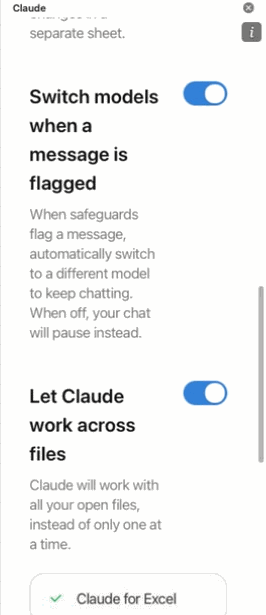
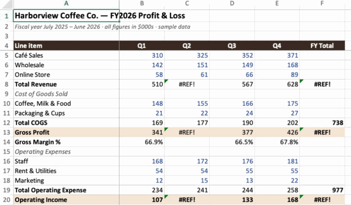
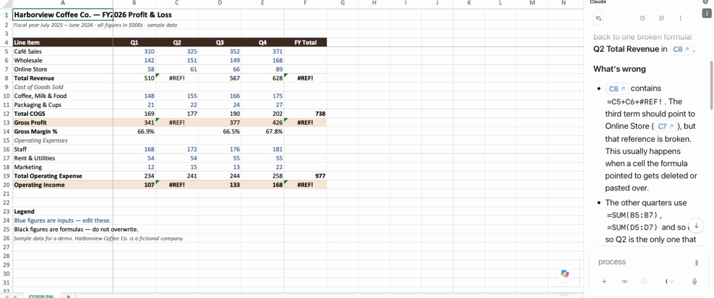
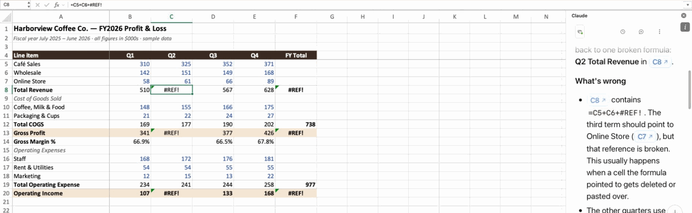
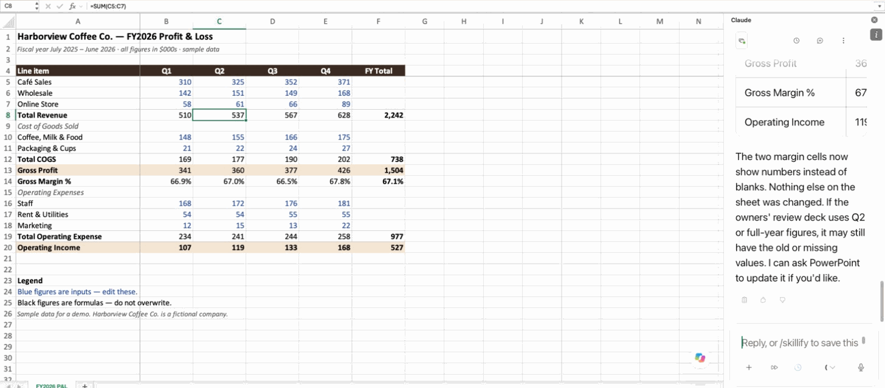
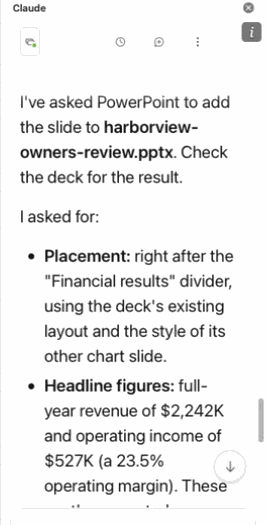
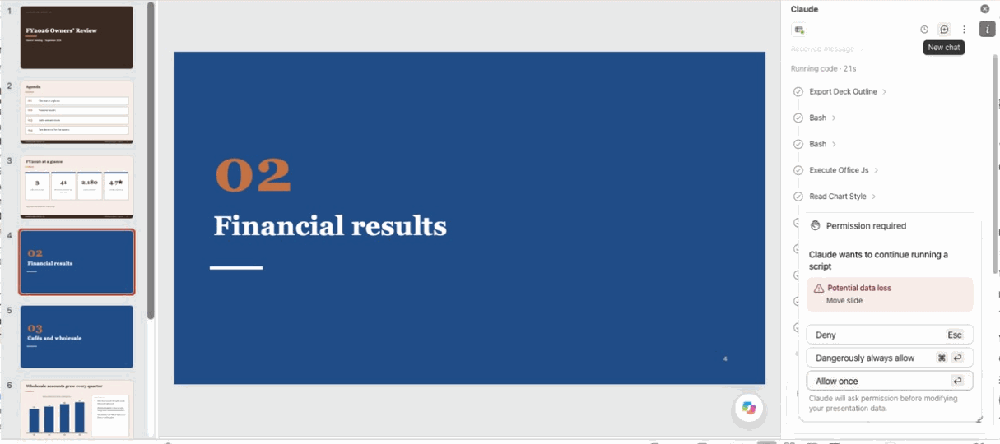
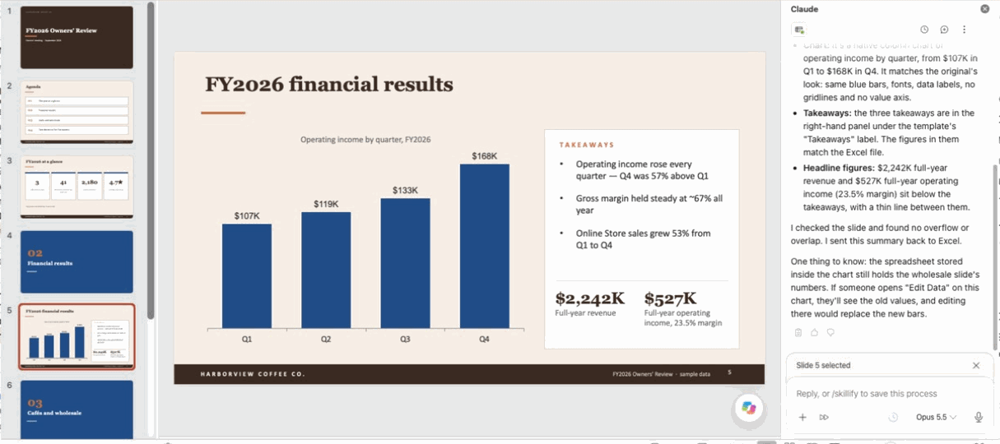
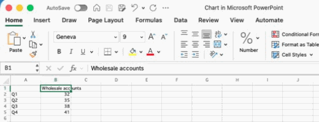

# DIY 7 — Claude in Excel and PowerPoint: one conversation, two apps

**Goes with:** Demo 7 in the talk (Excel + PowerPoint).
**Time:** about 10 minutes.
**Where:** desktop **Excel** and **PowerPoint** (Microsoft 365) with the **Claude add-in** installed in both and signed in to a paid Claude plan.
**The problem:** the owners' meeting is today. The finance workbook for **Harborview Coffee Co.** (made up) has a broken formula, and the owners' deck is missing its financial slide. In Excel, Claude finds and fixes the break, showing exactly which cells it means. Then, **without leaving Excel**, you ask it to build the missing slide in the open deck, on the deck's own template. The slide's numbers are only right *because* the workbook got fixed first.

**Files** (in [`diy-07-office/files/`](files/) in this repo, all sample data; the setup script copies them to `~/atc-diy/office/`, and those copies are the ones you open):

| File | What it is |
|---|---|
| `harborview-fy2026.xlsx` | A one-year P&L by quarter, in $000s. **One formula is broken**, and the error spreads. |
| `harborview-owners-review.pptx` | A 7-slide owners' deck on its own template. Slide 4, **"02 Financial results"**, has nothing after it. That's the gap. |

**What you'll practice:**

1. Claude works **inside** the apps you already use, on the live file, not a copy pasted into a chat.
2. **It shows its work:** cell references you can click, and a fix you approve.
3. **One conversation spans apps.** What it learned in Excel carries into PowerPoint, with no copy-paste.
4. **Your template, your brand:** it reads the deck's layouts, and the result stays editable.

---

## Get ready

From the top of this repo:

```bash
python3 setup_diy.py 7
```

It copies both files to `~/atc-diy/office/`. **Always open those copies**, so you can start over cleanly.

Then:

- [ ] Open `~/atc-diy/office/harborview-fy2026.xlsx` in Excel and `~/atc-diy/office/harborview-owners-review.pptx` in PowerPoint.
- [ ] In **both** apps, open the Claude add-in (the **Claude** button at the right end of the **Home** tab) and check it's **signed in and answering** (send "hi", then start a new conversation). Not installed? Get it from the Office Add-ins store (search "Claude").
- [ ] Turn on **"Let Claude work across files"** in **both** apps, and check each one separately: in our test it was on in Excel but **off** in PowerPoint, and step 4 failed until PowerPoint's was on too. In each add-in: the **⋮** menu at the top of the panel → **Settings** → scroll down. When it's on, it lists *Claude for Excel* and *Claude for PowerPoint* with check marks. Do this **before** step 2: switching it on can restart the add-in's conversation.

   

- [ ] In PowerPoint, go to **slide 4** ("02 Financial results").

---

## Steps

### 1. See the problem

In Excel, look at **Q2** and **FY Total**. Total Revenue, Gross Profit and Operating Income all show **#REF!** in Q2 and for the full year. Gross Margin for Q2 and for the full year is blank.



### 2. Ask about your own data

In the **Excel** add-in, paste:

```text
Why are Q2 and the full-year totals showing #REF!, and what would fix it? Don't change anything yet.
```

> The last sentence matters. When we asked only *"how do I fix it?"*, Claude in Excel went ahead and fixed the workbook in the same reply, without asking.

**What you should see:** an answer that names the cells. **C8** (Q2 Total Revenue) is `=C5+C6+#REF!`: it lost its link to the **Online Store** row (C7), and the error spreads to **F8, C13, F13, C20 and F20** (and blanks C14 and F14). The cell references should be clickable. Click one and Excel jumps there. It should end by saying it hasn't changed anything.





### 3. Fix it, with your OK

Paste:

```text
Go ahead and fix it.
```

**What you should see:** if it asks before changing the cell, read it and approve. (In both of our runs it didn't ask; it changed C8 and said so.) Then the errors clear:

| | Q1 | Q2 | Q3 | Q4 | FY |
|---|---|---|---|---|---|
| Total Revenue | 510 | **537** | 567 | 628 | **2,242** |
| Gross Profit | 341 | **360** | 377 | 426 | **1,504** |
| Operating Income | 107 | **119** | 133 | 168 | **527** |

One formula, and everything downstream recalculates. A correct fix is `=SUM(C5:C7)` or `=C5+C6+C7`; either gives 537.



### 4. Same conversation, different app

**Still in the Excel add-in**, paste:

```text
Now add a financial results slide to my open owners' deck, right after the "Financial results" divider: full-year revenue and operating income, a chart of operating income by quarter, and three short takeaways. Match the deck's template and the style of its other chart slide.
```

**What you should see:** Claude in Excel hands the job to Claude in PowerPoint and says so (something like *"I've passed the slide request to PowerPoint, so check the owners' deck there"*). You didn't copy a number or explain the workbook again.



**Now switch to PowerPoint and watch its Claude panel.** That's where the work happens, and it may stop to ask permission, for example *"Permission required… Potential data loss: Move slide"* when it moves the new slide into place. Nothing finishes until you answer. Read it and choose **Allow once**. It asked in both of our runs. It then works for a minute or two (*Edited 5 slides, read 4 slides…*) before it reports back.



### 5. Check the slide

Switch to PowerPoint and go to the new slide (slide 5).



- **The template:** same espresso footer, fonts and colors as the other slides, and ideally the same **"HV Chart and Takeaways"** layout as the "Wholesale accounts grew every quarter" slide (slide 6 before, slide 7 now). Flip to it and compare.
- **The numbers:** Q2 operating income is **119**, and the year is **527**. Those are only right because you fixed the workbook first.
- **It's editable:** click the chart. If the chart tools appear in the ribbon, it's a real PowerPoint chart, not a picture.
- **The chart's own data: read PowerPoint's summary before you touch the chart.** In both of our runs Claude built the slide by copying the wholesale chart slide, and its summary ended with a warning: the data stored inside the chart still held the **wholesale** numbers. That matters: when we opened **Chart Design → Edit Data** anyway, the bars jumped back to 32 / 35 / 38 / 41, and Undo didn't bring them back.

  

  If you see that warning, paste this into the **PowerPoint** add-in first:

  ```text
  Replace the chart's stored data with the four quarterly operating income values.
  ```

  In our run that fixed it: the bars went back to 107 / 119 / 133 / 168, and Edit Data then showed *Operating income ($000s)* with those four values. It also left an **extra copy** of the slide (slide 6), so check the slide count afterwards and delete the spare.

---

## Want more? (optional)

If you have **Word** with the Claude add-in, open a blank document and paste into either sidebar:

```text
Draft a five-sentence note to the owners in my open Word document: what was broken in the Q2 numbers, what we changed, and the corrected full-year operating income.
```

---

## Start over

Close the two files without saving (or quit Excel and PowerPoint), then:

```bash
python3 setup_diy.py 7   # from the top of this repo
```

Start a new conversation in each add-in.

## If something goes wrong

- **The add-in isn't answering:** sign in again from its sidebar.
- **Step 4 says it can't reach PowerPoint** (in our test: *"PowerPoint isn't connected to this session"*): "work across files" is off in one of the two add-ins (check PowerPoint's too), or the PowerPoint add-in isn't open. Turn it on, then paste the step 4 prompt again.
- **Step 4 says it's done, but the deck has no new slide** (or only a copy of the wholesale slide): look at the Claude panel **in PowerPoint**. It's probably waiting for you to allow a step.
- **Still can't reach it?** Workaround: in Excel ask *"Give me full-year revenue, operating income, and operating income by quarter as a small table,"* copy it, then in the **PowerPoint** add-in ask *"Add a slide after the Financial results divider with this data, a chart of operating income by quarter, and three takeaways, using this deck's template,"* and paste.
- **Q2 on the slide isn't 119:** it used the old numbers. Say so: *"Re-read the workbook and update the slide."* This is why you check.
- **It suggests a different fix:** read its reasoning. If Q2 revenue comes out at 537, it's right.
- **Excel or PowerPoint asks for permission to a folder ("Grant Access")** when you open the files: that's macOS asking on the app's behalf. We saw it with copies stored in OneDrive. **Grant Access** lets the app open the file; **Cancel** leaves it closed.
- **The chart is shapes, not a chart:** still fine: every piece is an editable PowerPoint shape.
- **No Excel or PowerPoint?** You can get a feel for it in a regular Claude chat: attach both files and ask the same questions. Claude will explain the fix and can make a new copy of the deck, but you lose the "live file, no copy-paste" part.
